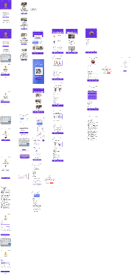

# GymPoint — Fitness App UI/UX Prototype

GymPoint is a **student team design project** for a fitness app. This repository documents the Figma design as a portfolio case study. It is a UI/UX prototype; there is no implemented mobile app or backend in this repository.

*Low-resolution overview embedded in the original Figma export. It is not a full-resolution screen export.*

## Design scope

The original Figma file, named **“Final Project-Group 4”**, contains wireframes and finished mobile screens. The design covers sign-in and account flows, a home view, and workout discovery and details. The canvas also includes additional fitness and account screens. These are design concepts, not evidence of implemented app functionality.

The project explores:

- Moving from a login wireframe to a more developed visual design.
- Structuring authentication and account-recovery screens.
- Organizing workout content in a mobile interface.
- Connecting screens as an interactive prototype in Figma.

## Source and preview

The source was provided as `Figma Project.fig`, exported from Figma on 30 April 2026. The export is approximately 100 MB because it contains embedded image assets, so it is not checked into this lightweight case-study repository. The included overview is taken from that export. A public Figma link and full-resolution exports can be added when available.

To inspect the design from the source export, import `Figma Project.fig` into Figma and review the frames and prototype connections there. The GitHub thumbnail is for orientation only.

## Credits and status

This is a **Group 4 team project** presented by **Stathis Bogris**. The available export identifies the group but does not list individual contributions, so this page does not attribute specific screens or interactions to one person. Additional collaborator credits can be added when confirmed.

The prototype has not been verified here as a working end-to-end product, and no application code is claimed. Embedded photographs in the source design are used in the team project with the team's permission to show the work; this repository does not distribute the original photo assets.

No open-source license has been granted for reuse of the design.
